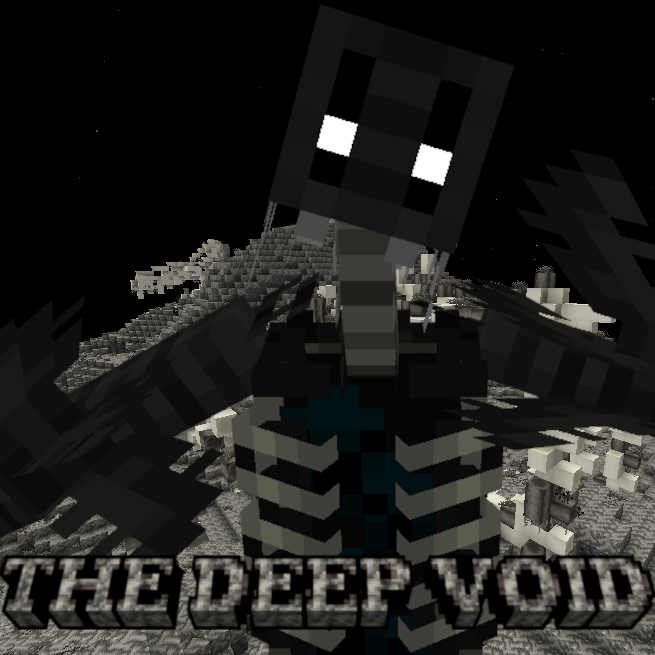
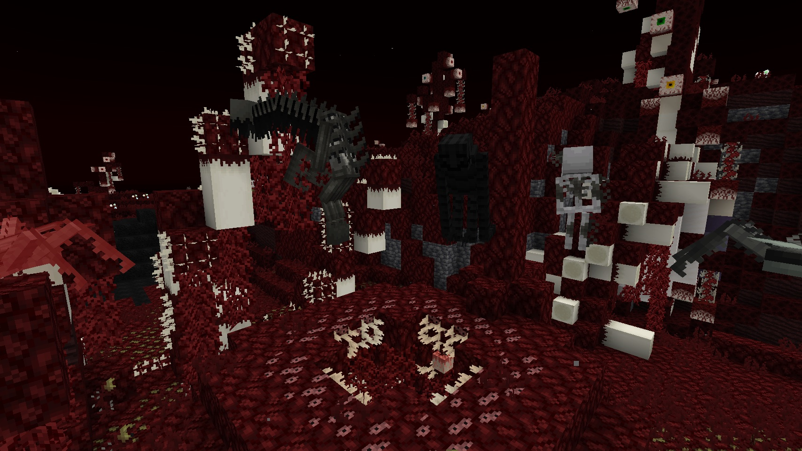
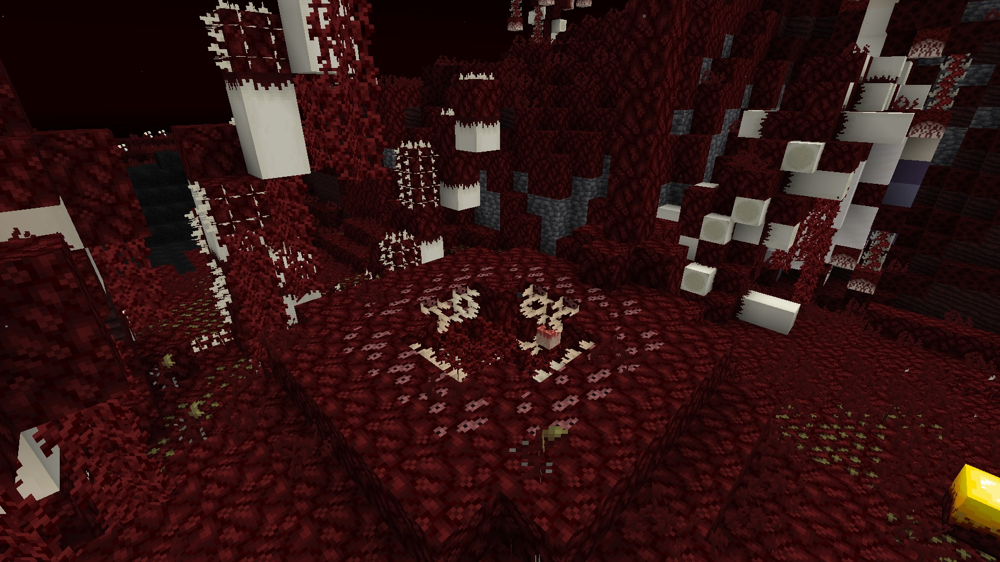
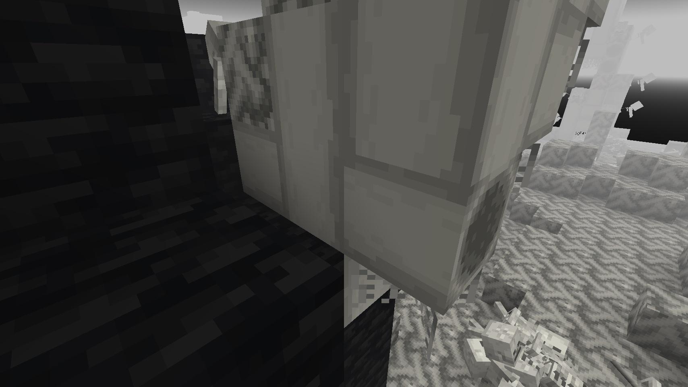
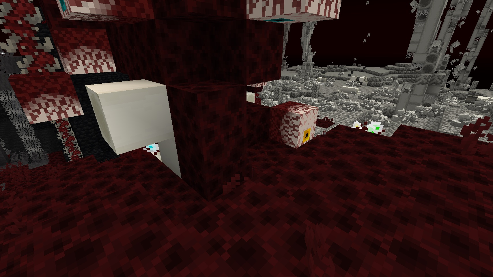

# The Deep Void — NeoForge 1.21.1

**Fall through the bedrock. Something down there has been waiting.**

An unofficial port of **[The Deep Void](https://www.curseforge.com/minecraft/mc-mods/the-deep-void)** v1.99.3.1
by **Sombrius** from Forge 1.20.1 to **NeoForge 1.21.1**, with all of its content.

---

## 🕳️ About the mod

The Deep Void adds a horror dimension beneath the bedrock: a desolate, forgotten void full of bones, flesh and things
that watch you from the dark. Explore 17 biomes, survive what lives there, uncover the lore of a lost civilisation and
fight bosses with complex attack patterns for some of the strongest gear in the game.

- **991 items, 472 blocks, 193 entities, 58 effects** — everything from the original 1.99.3.1
- **17 biomes** — bone dunes, flesh plains, graveyards, a monolith maze, the Staring Hills, the Crawler Nest, misted ruins…
- **Bosses** with their own music, arenas and loot — progression is guided by the advancements tab
- **Light is life** — the dimension's inhabitants hate light and break light sources. Stay in the dark too long and the
  Stalker comes for you
- **Hallucinations, abductions, curses, cursed treasure and secrets** — most of it configurable

## 🚪 How to get there

| Way in | |
| --- | --- |
| **The hole** | Fall into the void through the bedrock hole at **0, 0** (a structure at 0, −64, 0 makes it, even in old worlds) |
| **Cracked Bedrock** | Found in the Overworld — step on it and it breaks |
| **The End** | Falling into the void of the End also takes you down |
| **Abductors** | They grab you and carry you there… crouch to escape |

**Way out:** craft and use a **Void Pendant**.

## 📸 Screenshots

  
  
  
  

## 📦 Installation

1. Install **NeoForge 21.1.197** or newer for Minecraft **1.21.1**.
2. Put **[GeckoLib](https://modrinth.com/mod/geckolib)** (4.9 or newer, NeoForge 1.21.1) into `mods`.
3. Put `the-deep-void-neoforge-1.99.3.1+1.21.1.jar` from the [releases](../../releases) into `mods`.

Needed on both the client and the server. **JEI** is optional (custom recipe categories).
Settings: `config/Deep Void Config.toml` (or in game with the Configured mod).

## 🔧 What changed in the port

The content and the numbers are the same as in 1.20.1. Where Minecraft 1.21 works differently, the port keeps the
1.20.1 behaviour:

- Enchantments, paintings and music discs are 1.21 data (same costs, sizes, sounds and lengths).
- Undead / arthropod mobs are in the 1.21 entity tags, so Smite and Bane of Arthropods work as before.
- Arrows of the mod's weapons keep their own knockback; the guns keep their arm poses.
- World generation fixes: lakes of Liquid Void / Ichor no longer crash chunk generation on 1.21, big structures (giant
  skulls) are cut cleanly at the chunk border instead of spamming the log.

The full list (with the reasons) is in **[PORTLOG.md](PORTLOG.md)**.

## ❤️ Credits

- **The Deep Void** — made by **Sombrius** (The Deep Void Team) with MCreator ·
  [CurseForge](https://www.curseforge.com/minecraft/mc-mods/the-deep-void) ·
  [source & wiki](https://github.com/TroupeMaster/TheDeepVoid). All the content, art, sounds and ideas are theirs.
- **Port** to NeoForge 1.21.1 — [Vladeezyy](https://github.com/Vladeezyy).
- Bugs of **this port**: [issues](../../issues). Please don't report port bugs to the original author.

MIT License, like the original.

---

<b>🇷🇺 Описание на русском</b>

 

**Провалитесь сквозь бедрок. Там, внизу, вас уже ждут.**

Неофициальный порт мода **[The Deep Void](https://www.curseforge.com/minecraft/mc-mods/the-deep-void)** v1.99.3.1
от **Sombrius** с Forge 1.20.1 на **NeoForge 1.21.1** — со всем содержимым.

<b>🕳️ О моде</b>

The Deep Void добавляет хоррор-измерение под бедроком: заброшенную, забытую пустоту из костей, плоти и того, что следит
за вами из темноты. Исследуйте 17 биомов, выживите среди местных обитателей, раскройте историю исчезнувшей цивилизации и
сразитесь с боссами со сложными атаками ради одного из самых сильных снаряжений в игре.

- **991 предмет, 472 блока, 193 сущности, 58 эффектов** — всё из оригинальной версии 1.99.3.1
- **17 биомов** — костяные дюны, равнины плоти, кладбища, лабиринт монолитов, Взирающие холмы, Гнездо ползунов, туманные руины…
- **Боссы** со своей музыкой, аренами и добычей — путь подсказывает вкладка достижений
- **Свет — это жизнь**: обитатели измерения ненавидят свет и ломают его источники. Задержитесь в темноте слишком
  долго — и за вами придёт Сталкер
- **Галлюцинации, похищения, проклятия, проклятые сокровища и секреты** — почти всё настраивается

<b>🚪 Как туда попасть</b>

| Способ | |
| --- | --- |
| **Дыра** | Упасть в пустоту через дыру в бедроке на **0, 0** (её делает структура на 0, −64, 0 — даже в старых мирах) |
| **Треснувший бедрок** | Встречается в Верхнем мире — наступите, и он сломается |
| **Энд** | Падение в пустоту Энда тоже ведёт вниз |
| **Похитители** | Схватят и унесут… присядьте, чтобы вырваться |

**Выход:** скрафтите и используйте **Кулон пустоты** (Void Pendant).

<b>📦 Установка</b>

1. Установите **NeoForge 21.1.197** или новее для Minecraft **1.21.1**.
2. Положите в `mods` **[GeckoLib](https://modrinth.com/mod/geckolib)** (4.9 или новее, NeoForge 1.21.1).
3. Положите в `mods` файл `the-deep-void-neoforge-1.99.3.1+1.21.1.jar` из [релизов](../../releases).

Нужен и на клиенте, и на сервере. **JEI** — по желанию (свои категории рецептов).
Настройки: `config/Deep Void Config.toml` (или в игре через мод Configured).

<b>🔧 Что изменилось при портировании</b>

Содержимое и все числа — как в 1.20.1. Там, где Minecraft 1.21 устроен иначе, порт сохраняет поведение 1.20.1:

- Зачарования, картины и музыкальные диски стали данными 1.21 (те же стоимости, размеры, звуки и длительность).
- Нежить и членистоногие мода — в тегах сущностей 1.21, поэтому «Небесная кара» и «Бич членистоногих» работают как раньше.
- Стрелы оружия мода сохранили свою отдачу, у пушек остались свои позы рук.
- Исправления генерации мира: озёра Жидкой пустоты / Ихора больше не роняют генерацию чанков на 1.21, большие
  структуры (гигантские черепа) аккуратно обрезаются по границе чанка вместо сотен ошибок в логе.

Полный список (с причинами) — в **[PORTLOG.md](PORTLOG.md)**.

<b>❤️ Авторы</b>

- **The Deep Void** — автор **Sombrius** (The Deep Void Team), сделан в MCreator ·
  [CurseForge](https://www.curseforge.com/minecraft/mc-mods/the-deep-void) ·
  [исходники и вики](https://github.com/TroupeMaster/TheDeepVoid). Всё содержимое, графика, звуки и идеи — их.
- **Порт** на NeoForge 1.21.1 — [Vladeezyy](https://github.com/Vladeezyy).
- Ошибки **этого порта** — в [issues](../../issues). Пожалуйста, не отправляйте ошибки порта автору оригинала.

Лицензия MIT, как у оригинала.

